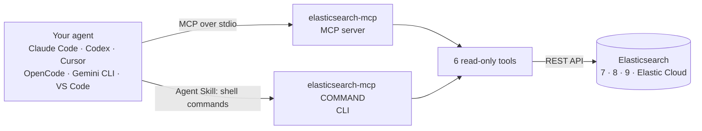

<div align="center">


# elasticsearch-mcp

**Read-only Elasticsearch for any AI agent: plug it in as an MCP server, or as an Agent Skill where MCP isn't allowed.**

[](LICENSE)
[](pyproject.toml)
[](https://modelcontextprotocol.io)
[](skills/elasticsearch/SKILL.md)
[](https://www.elastic.co/elasticsearch)
[](#read-only-by-design)

**Works with**


</div>

---

Ask your agent *"Which hosts logged the most errors today?"* and it finds the index, reads the mappings and runs the query itself. One small Python package gives every agent the same six read-only tools, two ways:



## Quick start

You need [uv](https://docs.astral.sh/uv/), your cluster's URL and an API key (here's a [read-only key](#read-only-by-design)).

1. Add the server to your agent. For Claude Code:
   ```bash
   claude mcp add --scope user elasticsearch -e ES_URL=https://your-cluster:9200 -e ES_API_KEY=your-key -- uvx --from git+https://github.com/aniketshukla1/elasticsearch-mcp elasticsearch-mcp
   ```
   Other agents: [MCP setup](#use-it-as-an-mcp-server). MCP not allowed: [Agent Skill](#use-it-as-an-agent-skill).
2. Restart the agent.
3. Ask: *"What indices do I have, and which is the largest?"*

No cluster yet? [Develop locally](#develop-locally) starts one in Docker with sample data.

## Use it as an MCP server

Every client launches the same command and passes the settings as environment variables:

```text
uvx --from git+https://github.com/aniketshukla1/elasticsearch-mcp elasticsearch-mcp
```

<details>
<summary><b>Claude Code</b></summary>

```bash
claude mcp add --scope user elasticsearch -e ES_URL=https://your-cluster:9200 -e ES_API_KEY=your-key -- uvx --from git+https://github.com/aniketshukla1/elasticsearch-mcp elasticsearch-mcp
```

Keep the name `elasticsearch` before the `-e` flags, or `-e` swallows it.
</details>

<details>
<summary><b>Codex</b></summary>

```bash
codex mcp add elasticsearch --env ES_URL=https://your-cluster:9200 --env ES_API_KEY=your-key -- uvx --from git+https://github.com/aniketshukla1/elasticsearch-mcp elasticsearch-mcp
```
</details>

<details>
<summary><b>Cursor, Gemini CLI, Claude Desktop and other JSON configs</b></summary>

Add this to `~/.cursor/mcp.json`, `~/.gemini/settings.json` or `claude_desktop_config.json`:

```json
{
  "mcpServers": {
    "elasticsearch": {
      "command": "uvx",
      "args": ["--from", "git+https://github.com/aniketshukla1/elasticsearch-mcp", "elasticsearch-mcp"],
      "env": { "ES_URL": "https://your-cluster:9200", "ES_API_KEY": "your-key" }
    }
  }
}
```

Desktop apps may not see your shell's `PATH`. If the server doesn't start, use the full path from `which uvx` as `command`. Cursor asks you to approve the server the first time.
</details>

<details>
<summary><b>OpenCode</b></summary>

Add this to `~/.config/opencode/opencode.json`:

```json
{
  "$schema": "https://opencode.ai/config.json",
  "mcp": {
    "elasticsearch": {
      "type": "local",
      "command": ["uvx", "--from", "git+https://github.com/aniketshukla1/elasticsearch-mcp", "elasticsearch-mcp"],
      "environment": { "ES_URL": "https://your-cluster:9200", "ES_API_KEY": "your-key" }
    }
  }
}
```
</details>

<details>
<summary><b>VS Code</b></summary>

```bash
code --add-mcp '{"name":"elasticsearch","command":"uvx","args":["--from","git+https://github.com/aniketshukla1/elasticsearch-mcp","elasticsearch-mcp"],"env":{"ES_URL":"https://your-cluster:9200","ES_API_KEY":"your-key"}}'
```

If `code` opens Cursor (Cursor can install its own `code` command), run VS Code's CLI by its full path: `"/Applications/Visual Studio Code.app/Contents/Resources/app/bin/code"`.
</details>

The server also ships an MCP prompt, `elasticsearch(question)`. Clients that support MCP prompts, such as Claude Code and VS Code, list it as a slash command.

## Use it as an Agent Skill

Some setups don't allow MCP servers. The skill in [`skills/elasticsearch`](skills/elasticsearch/SKILL.md) teaches the agent to run the same six tools as shell commands, or as plain `curl` calls when uv isn't installed. It follows the open [Agent Skills](https://agentskills.io) format, so one folder works in every agent that supports skills.

Install it into all your agents at once with the [`skills`](https://github.com/vercel-labs/skills) installer:

```bash
npx skills add aniketshukla1/elasticsearch-mcp
```

Or copy the folder into one agent's skills directory:

| Agent | Skills directory |
|---|---|
| Claude Code | `~/.claude/skills/` |
| Codex | `~/.codex/skills/` |
| Cursor | `~/.cursor/skills/` |
| OpenCode | `~/.config/opencode/skills/` |
| Gemini CLI | `~/.gemini/skills/` |
| GitHub Copilot | `~/.copilot/skills/` |

```bash
git clone https://github.com/aniketshukla1/elasticsearch-mcp
cp -r elasticsearch-mcp/skills/elasticsearch ~/.claude/skills/
```

The skill reads the same environment variables as the server. Ask about your data and the agent loads it; in Claude Code you can also type `/elasticsearch`. The commands work by hand too:

```bash
uvx --from git+https://github.com/aniketshukla1/elasticsearch-mcp elasticsearch-mcp list-indices 'logs-*'
uvx --from git+https://github.com/aniketshukla1/elasticsearch-mcp elasticsearch-mcp esql 'FROM logs-* | STATS n = COUNT(*) BY host.name | LIMIT 5'
```

## Tools

| MCP tool | CLI command | Elasticsearch API |
|---|---|---|
| `list_indices(pattern="*")` | `list-indices [PATTERN]` | `GET _cat/indices/{pattern}` |
| `get_mappings(index)` | `get-mappings INDEX` | `GET {index}/_mapping` |
| `search(index, body)` | `search INDEX [BODY]` | `POST {index}/_search`: Query DSL, aggregations |
| `esql(query)` | `esql QUERY` | `POST _query`: ES\|QL, Elasticsearch 8.11+ |
| `get_shards(index="*")` | `get-shards [PATTERN]` | `GET _cat/shards/{index}` |
| `cluster_health()` | `cluster-health` | `GET _cluster/health` |

Results are Elasticsearch's own compact JSON. Errors come back with Elasticsearch's reason, so the agent can fix its query.

## Settings

| Variable | Meaning |
|---|---|
| `ES_URL` | Cluster URL. Default `http://localhost:9200` |
| `ES_API_KEY` | Preferred. The `encoded` value from `POST _security/api_key` |
| `ES_USERNAME`, `ES_PASSWORD` | Basic auth, used when `ES_API_KEY` is empty |
| `ES_CA_CERT` | CA bundle path for self-signed TLS, such as `http_ca.crt` |

## Read-only by design

No tool or command writes, deletes or changes settings: there is nothing to call. To make sure nothing else can either (a `curl` from the skill's fallback, say), give the agent a key that can't write. This role covers all six tools; narrow `names` to the indices the agent should see:

```
POST /_security/api_key
{
  "name": "mcp-read-only",
  "role_descriptors": {
    "mcp_read_only": {
      "cluster": ["monitor"],
      "indices": [{ "names": ["*"], "privileges": ["read", "view_index_metadata", "monitor"] }]
    }
  }
}
```

Use the `encoded` value from the response as `ES_API_KEY`.

## Develop locally

```bash
cp .env.example .env                       # then set ES_PASSWORD
docker compose up -d --wait                # Elasticsearch 9.5.5 on 127.0.0.1:9200
uv run --env-file .env tests/test_e2e.py   # end-to-end test of the MCP server and the CLI
```

The test seeds the `mcp-demo-products` index, then checks every tool and the prompt over MCP and every CLI command, once with a read-only API key and once with the password. To point an agent at your checkout instead of GitHub, use this command:

```text
uv run --directory /path/to/elasticsearch-mcp --env-file .env elasticsearch-mcp
```

```text
elasticsearch-mcp/
├── src/elasticsearch_mcp/
│   ├── server.py        MCP server: six read-only tools and the elasticsearch prompt
│   └── cli.py           the elasticsearch-mcp command: serves MCP, or runs one tool from the shell
├── skills/elasticsearch/
│   └── SKILL.md         Agent Skill for agents without MCP
├── tests/test_e2e.py    end-to-end test against a real cluster
├── assets/logo.svg
├── docker-compose.yml   local Elasticsearch
└── .env.example         settings template
```

## License

[MIT](LICENSE)
